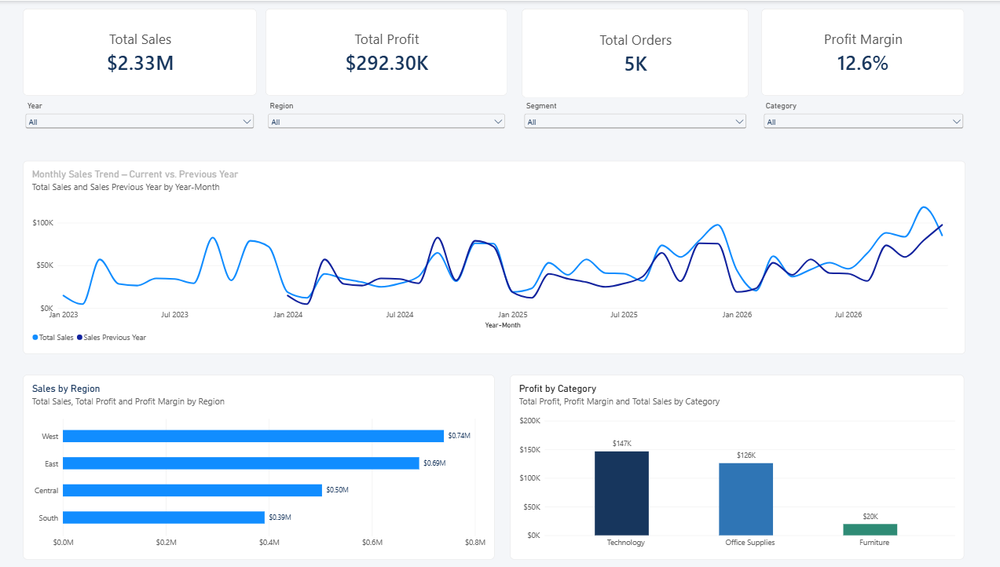
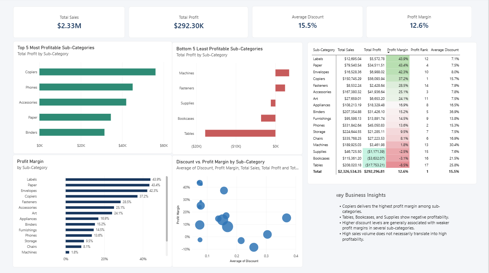
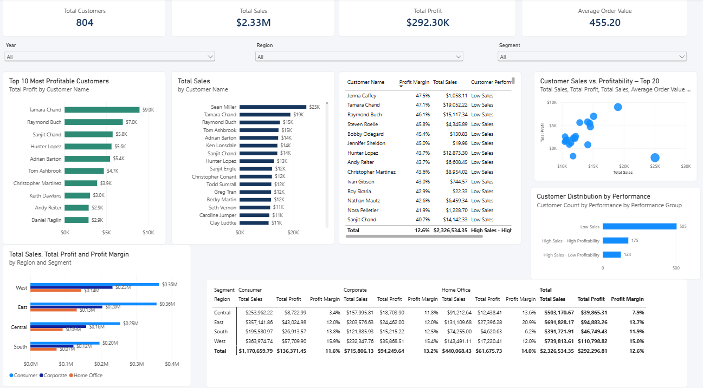
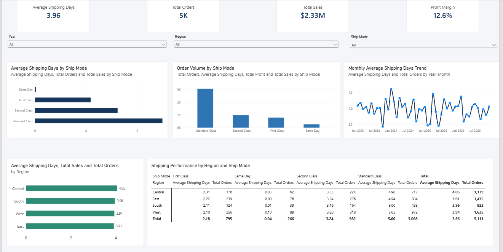
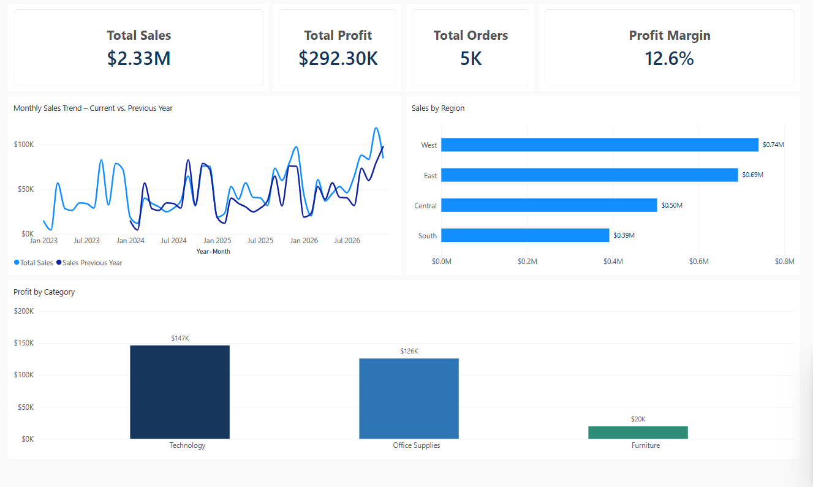

# Retail Sales & Profitability Analysis | Power BI

## Project Overview

An interactive Power BI report and executive dashboard developed using the Sample Superstore dataset to analyze retail business performance, profitability, customer behavior, and shipping operations.

The project demonstrates an end-to-end Business Intelligence workflow, from data preparation and modeling to DAX calculations, interactive visualizations, and business insights.

## Business Objectives

The analysis focuses on eight key business questions:

1. How do sales and profitability change over time?
2. Which regions generate the highest sales and profit?
3. Which product categories and sub-categories are the most and least profitable?
4. How are discount levels associated with profit margins?
5. Which customers generate the highest sales and profit?
6. Do high-sales customers necessarily generate higher profits?
7. How does customer performance vary across segments and regions?
8. How do shipping modes and regions affect order-to-ship time?

## Tools & Technologies

- Microsoft Power BI Desktop
- Power BI Service
- Power Query
- DAX (Data Analysis Expressions)
- Data Modeling
- Data Visualization
- Business Intelligence

## Data Preparation & Modeling

- Cleaned and transformed data using Power Query.
- Created a Calendar table for time-based analysis.
- Established relationships between fact and date tables.
- Created an additional date relationship to analyze sales by shipping date.
- Developed calculated columns and DAX measures for business KPIs.

## DAX Techniques

The project uses a range of DAX functions and analytical techniques, including:

- CALCULATE, FILTER, and REMOVEFILTERS
- ALLSELECTED and SELECTEDVALUE
- RANKX and TOPN
- AVERAGEX
- SWITCH and conditional logic
- USERELATIONSHIP and CROSSFILTER
- Time Intelligence functions
- Disconnected tables and customer segmentation

## Report Structure

### 1. Executive Overview
High-level business performance indicators, sales trends, regional performance, and category profitability.

### 2. Product & Profitability Analysis
Top and bottom performing sub-categories, discount analysis, profit margins, and detailed profitability comparisons.

### 3. Customer & Regional Analysis
Customer performance segmentation, top customers, sales and profitability comparisons, and regional analysis by customer segment.

### 4. Shipping Performance Analysis
Order-to-ship time, shipping mode comparisons, regional shipping performance, and monthly trends.

## Key Business Insights

- Total sales reached approximately $2.33M, with total profit of approximately $292.30K.
- Overall profit margin was approximately 12.6%.
- Technology generated the highest category profit.
- Copiers showed particularly strong profitability, while Tables, Bookcases, and Supplies had negative profit margins.
- High sales volume did not always translate into high profitability.
- Higher discount levels were associated with weaker profit margins in several sub-categories.
- Standard Class was the most frequently used shipping mode and had the longest average order-to-ship time.

## Key Deliverables

- Four-page interactive Power BI report.
- Executive dashboard published through Power BI Service.
- Business KPI analysis and customer segmentation.
- DAX measures and data model.

## Dataset

Sample Superstore public sample dataset.

**Note:** This is an educational portfolio project using sample data. Shipping analysis measures the time between order date and ship date, not final customer delivery time.

---

**Author:** Hosna Zolfaghari  
**Focus:** Data Analytics | Business Intelligence | Power BI

---

## Report Preview

### 1. Executive Overview

### 2. Product & Profitability Analysis

### 3. Customer & Regional Analysis

### 4. Shipping Performance Analysis

### 5. Executive Dashboard

